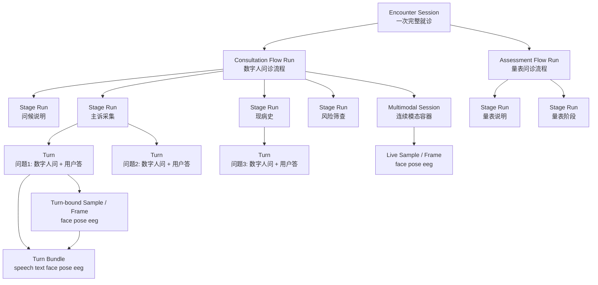

# 多模态层级架构问答

## 1. 这份文档回答什么问题

这份文档专门回答数字人问诊与量表问诊中的层级问题：

- `turn` 到底是什么
- `stage` 怎么定义
- `flow` 怎么定义
- `session` 应该指哪一层
- 连续模态的 `frame / sample` 该挂在哪一层
- 当前仓库的字段语义和推荐设计分别是什么

本文给出一个推荐的 5 层层级模型，并标出当前仓库中已经存在的字段与后续推荐新增的字段。

## 2. 推荐的 5 层层级是什么

### Q1：为什么要拆成 5 层？

因为数字人问诊里的数据天然跨越 5 个时间和业务尺度：

1. 一次完整就诊
2. 一个业务流程
3. 流程中的一个阶段
4. 阶段中的一次问答窗口
5. 问答窗口或会话中的单次连续模态采样

如果不拆层，后面就会把：

- `数字人问诊流程`
- `量表问诊流程`
- `主诉采集阶段`
- `一个问题的用户回答`
- `一张表情图片 / 一个 EEG 窗口`

混在同一个 `session` 里，导致字段语义越来越乱。

### Q2：推荐的 5 层分别是什么？

| 层级 | 推荐实体名             | 含义                                                          | 是否建议单独建表               |
| ---- | ---------------------- | ------------------------------------------------------------- | ------------------------------ |
| L1   | `encounter_session`  | 一次完整就诊会话，覆盖数字人问诊 + 量表问诊                   | 是                             |
| L2   | `flow_run`           | 某个流程的一次运行，例如数字人问诊流程、量表问诊流程          | 当前先继续分表实现             |
| L3   | `stage_run`          | 某个流程中的一个阶段，例如主诉采集、现病史、风险筛查          | 不一定单独建表，可先由字段表达 |
| L4   | `turn`               | 一次完整问答窗口，数字人问一个问题，用户完成一次回答          | 是，当前已有                   |
| L5   | `sample` / `frame` | 连续模态中的单次采样，例如一张图、一段 EEG 窗口、一次推理结果 | 是，当前已有                   |

## 3. 层级链路图

### Q3：推荐的层级链路图长什么样？



### Q4：这个链路图表达的核心约束是什么？

核心约束只有三条：

1. `encounter_session` 是最高层，代表整次就诊。
2. `consultation` 和 `assessment` 是两个不同的 `flow_run`，不应该混成一个表意不清的 `session`。
3. `turn` 只代表一次问答窗口；`frame/sample` 是更细粒度的连续模态采样。

## 4. 每一层推荐字段名是什么

### Q5：L1 `encounter_session` 推荐怎么设计？

用途：表示一次完整就诊。

推荐主字段：

| 字段名                   | 含义                                                |
| ------------------------ | --------------------------------------------------- |
| `encounter_session_id` | 顶层就诊会话主键                                    |
| `user_id`              | 用户主键                                            |
| `entry_flow_type`      | 从哪个流程进入，例如 `consultation`               |
| `current_flow_type`    | 当前正在运行的流程                                  |
| `status`               | 顶层状态，例如 `in_progress / completed / paused` |
| `started_at`           | 就诊开始时间                                        |
| `completed_at`         | 就诊结束时间                                        |
| `created_at`           | 创建时间                                            |
| `updated_at`           | 更新时间                                            |

当前仓库现状：

- 当前已经有 `encounter_sessions`。
- consultation / assessment / multimodal 主链已经开始写 `encounter_session_id`，但前端与文档口径仍在继续收口。

### Q6：L2 `flow_run` 推荐怎么设计？

用途：表示某个流程的一次运行。

推荐语义字段：

| 字段名                   | 含义                              |
| ------------------------ | --------------------------------- |
| `flow_run_id`          | 流程运行主键                      |
| `encounter_session_id` | 所属完整就诊                      |
| `flow_type`            | `consultation` / `assessment` |
| `workflow_id`          | 工作流模板标识                    |
| `status`               | 流程状态                          |
| `started_at`           | 流程开始时间                      |
| `completed_at`         | 流程结束时间                      |

当前仓库现状：

- 数字人问诊流程由 `consultation_sessions.id` 表示。
- 量表问诊流程由 `assessment_sessions.id` 表示。
- 当前已经改成 `assessment_sessions.source_consultation_flow_run_id` 回链数字人问诊流程，但物理表名仍未重命名。

当前已有字段对应：

| 当前表                    | 当前字段                               | 语义                   |
| ------------------------- | -------------------------------------- | ---------------------- |
| `consultation_sessions` | `id`                                 | 数字人问诊流程实例主键 |
| `consultation_sessions` | `workflow_id`                        | 数字人问诊工作流 ID    |
| `assessment_sessions`   | `id`                                 | 量表问诊流程实例主键   |
| `assessment_sessions`   | `source_consultation_flow_run_id`    | 与数字人问诊流程的关联 |

### Q7：L3 `stage_run` 推荐怎么设计？

用途：表示流程里的阶段。

推荐字段：

| 字段名          | 含义                 |
| --------------- | -------------------- |
| `stage_id`    | 阶段主键或稳定标识   |
| `stage_label` | 阶段名称，如主诉采集 |
| `stage_order` | 阶段顺序             |
| `flow_run_id` | 所属流程实例         |
| `entered_at`  | 进入阶段时间         |
| `exited_at`   | 离开阶段时间         |
| `status`      | 阶段状态             |

当前仓库现状：

- `consultation_sessions.current_stage_id` 表示当前数字人问诊内部阶段。
- `consultation_turns.stage_id` 表示某一轮问答所属阶段。
- `workflow_stage_id` 是更高一层的流程大阶段，不等于数字人内部 `stage_id`。

当前已有字段对应：

| 当前表                    | 当前字段              | 语义               |
| ------------------------- | --------------------- | ------------------ |
| `consultation_sessions` | `workflow_stage_id` | 更高层工作流阶段   |
| `consultation_sessions` | `current_stage_id`  | 当前数字人内部阶段 |
| `consultation_turns`    | `stage_id`          | 当前问答所属阶段   |

### Q8：L4 `turn` 推荐怎么设计？

用途：表示一次完整问答窗口。

定义：

- 数字人播一个问题视频
- 用户在该问题下完成一次回答
- 这一整个回答窗口就是一个 `turn`

推荐字段：

| 字段名                       | 含义               |
| ---------------------------- | ------------------ |
| `turn_id`                  | 问答窗口主键       |
| `flow_run_id`              | 所属流程实例       |
| `stage_id`                 | 所属阶段           |
| `question_key`             | 当前问题唯一键     |
| `turn_index`               | 当前流程中的第几轮 |
| `question_video_uri`       | 当前数字人视频     |
| `turn_window_started_at`   | 回答窗口开始时间   |
| `turn_window_completed_at` | 回答窗口结束时间   |
| `transcript_text`          | 本轮最终文本       |
| `turn_summary_payload`     | 本轮多模态汇总     |

当前仓库现状：

- `consultation_turns.id` 就是当前 `turn_id`。
- 当前 `turn_id` 生成得偏晚，主要在录音完成时才稳定存在。
- 推荐改成：**回答窗口一打开就预先生成 `turn_id`**，这样本轮所有 face/pose/EEG sample 都能正确归属到这一轮。

当前已有字段对应：

| 当前表                 | 当前字段                    | 语义               |
| ---------------------- | --------------------------- | ------------------ |
| `consultation_turns` | `id`                      | `turn_id`        |
| `consultation_turns` | `question_key`            | 当前问题键         |
| `consultation_turns` | `turn_index`              | 当前流程内轮次     |
| `consultation_turns` | `turn_window_started_at`  | 回答窗口开始时间   |
| `consultation_turns` | `turn_window_completed_at` | 回答窗口结束时间   |
| `consultation_turns` | `turn_summary_payload`    | 本轮多模态聚合结果 |

### Q9：L5 `sample / frame` 推荐怎么设计？

用途：表示连续模态中的单次采样。

推荐字段：

| 字段名                    | 含义                                  |
| ------------------------- | ------------------------------------- |
| `sample_id`             | 单次采样主键                          |
| `multimodal_session_id` | 所属多模态会话                        |
| `flow_run_id`           | 所属流程实例                          |
| `turn_id`               | 所属问答窗口，可空                    |
| `stage_id`              | 所属阶段                              |
| `question_key`          | 当前问题键                            |
| `modality`              | `face / pose / eeg / speech / text` |
| `sample_index`          | 连续采样序号                          |
| `captured_at`           | 采样时间                              |
| `capture_payload`       | 原始采样载荷                          |
| `inference_payload`     | 推理结果载荷                          |

当前仓库现状：

- `multimodal_captures` 存采样记录。
- `multimodal_inference_results` 存推理结果。
- 当前已经统一成 `turn_id`，并且它允许为空；这是合理的，因为有些 sample 只是会话级实时采样，不属于某一轮问答。

推荐语义规则：

| 场景                             | `turn_id` 是否可空 |
| -------------------------------- | -------------------- |
| 会话级实时看板 sample            | 可空                 |
| 明确属于某一轮回答窗口的 sample  | 不可空               |
| 要进入 `turn_bundle` 的 sample | 不可空               |

## 5. face / pose / EEG / speech / text 应该挂在哪一层

### Q10：表情、姿态、EEG 应该挂在哪里？

应该同时支持两种归属：

1. `live` 级实时数据作用：驱动实时看板归属：`multimodal_session` 下的最近一次 `sample`
2. `turn` 级窗口数据
   作用：构建 `turn_bundle`
   归属：某一轮回答窗口下的全部 `sample`

也就是说：

- `face / pose / eeg` 是连续模态
- 它们既有实时意义，也有 turn 聚合意义

### Q11：语音、文本应该挂在哪里？

语音和文本天然更适合挂在 `turn` 层：

- 语音是一次回答
- 文本是这次回答的转写和文本情绪

所以推荐：

- `speech` -> `turn`
- `text` -> `turn`
- `face / pose / eeg` -> `live + turn`

## 6. turn 级表情 / 姿态 / EEG 应该怎么统计

### Q12：一个 turn 里只记录一帧表情 / 姿态结果合理吗？

不合理。

如果 turn 代表一次完整回答窗口，那么 turn 级的 face / pose / EEG 应该统计的是：

- 这一轮窗口里所有 sample 的分布
- 而不是最后一帧或某一帧

### Q13：推荐怎么记录 turn 级分布？

推荐把分布作为主统计结果。

推荐结构：

```json
{
  "summary_type": "turn_window",
  "sample_count": 20,
  "valid_sample_count": 20,
  "label_distribution": [
    {"label": "平静", "count": 10, "ratio": 0.50},
    {"label": "难过", "count": 7, "ratio": 0.35},
    {"label": "开心", "count": 3, "ratio": 0.15}
  ],
  "quality_flags": {
    "no_pose_ratio": 0.05,
    "body_cutoff_ratio": 0.10,
    "motion_blur_ratio": 0.00
  }
}
```

### Q14：要让 turn 级分布统计成立，采样链路要满足什么条件？

必须满足这个约束：

- 回答窗口开始时就生成 `turn_id`
- 回答窗口内所有 face / pose / eeg sample 都绑定该 `turn_id`
- 回答窗口结束时再聚合出 `turn_bundle`

如果 `turn_id` 只在录音结束后才生成，那么连续模态就只能拿到尾部几帧，无法形成完整 turn 分布。

## 7. 当前系统哪里对，哪里不够对

### Q15：当前系统里哪些地方已经是对的？

当前系统里已经对的部分：

- `consultation_turns` 作为 turn 层实体是对的
- `consultation_sessions.workflow_stage_id` 与 `stage_id` 共存的分层方式仍可作为后续可进可退的保留能力
- `multimodal_captures` / `multimodal_inference_results` 作为 sample 层实体是对的
- `multimodal_turn_bundles` 作为 turn 聚合载体也是对的

### Q16：当前系统哪里不够对？

当前系统主要有 4 个问题：

1. 顶层缺少 `encounter_session`
2. `consultation session` 现在被当成流程级 session，而不是整次就诊级 session
3. `turn_id` 生成偏晚，导致连续模态无法完整绑定到 turn
4. `turn_bundle` 设计目标是 turn 聚合，但当前输入数据更多像“少量补采帧”，不是完整 turn 窗口

## 8. 最后结论

### Q17：当前仓库里 `session` 指的是谁？

当前仓库里，`session` 这个词大多数时候实际指的是：

- 一次数字人问诊流程实例

而不是：

- 数字人问诊流程 + 量表问诊流程的完整就诊实例

所以当前代码不是“错”，而是**层级还没补到最上层**。

### Q18：现在物理表名为什么还是旧名字？

因为当前重构先收口的是**字段语义、写路径、读路径和约束**，不是表名本身。

也就是说：

- 现在对外字段和运行时口径已经尽量切到 `encounter / flow_run / turn / sample`
- 但数据库物理表名仍保持：
  - `consultation_sessions`
  - `assessment_sessions`
  - `multimodal_sessions`
  - `multimodal_captures`
  - `multimodal_inference_results`
  - `multimodal_turn_bundles`

这是有意保留，不是漏改。原因是物理表重命名的破坏面更大，而当前收益主要是命名整洁，不影响主链运行。

### Q19：推荐的最终口径是什么？

推荐口径：

- `encounter_session`：完整就诊
- `consultation_session`：数字人问诊流程运行实例
- `assessment_session`：量表问诊流程运行实例
- `stage_id`：流程内部阶段
- `turn_id`：一次问答窗口
- `sample/frame`：一次连续模态采样

这套口径稳定以后，前端、服务、数据库、文档就能共用同一套语义。
